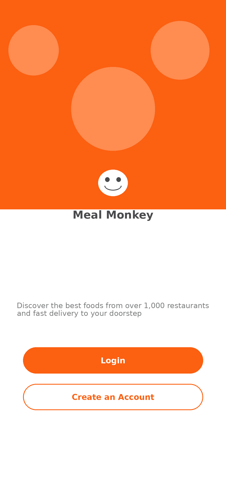
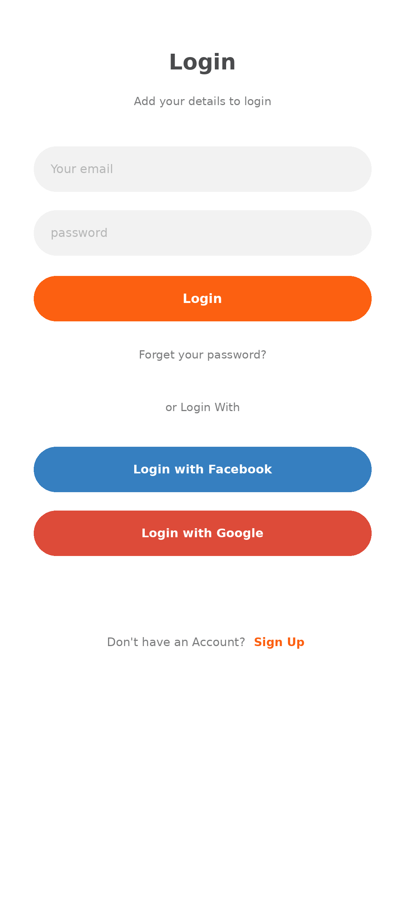
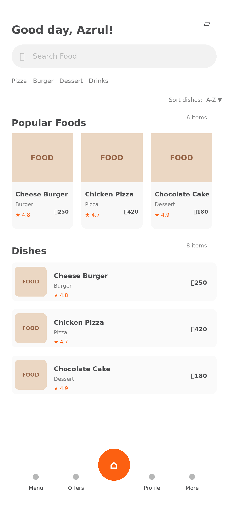
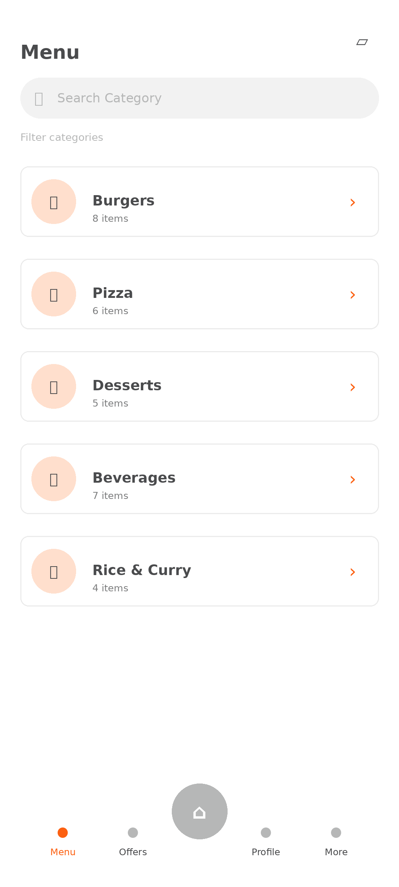
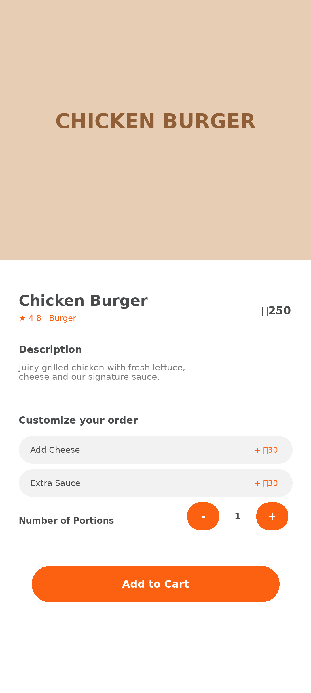
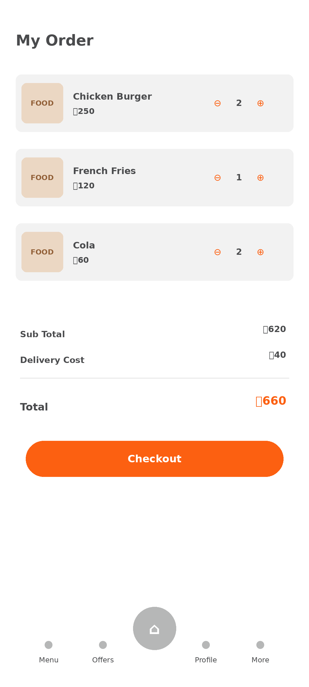
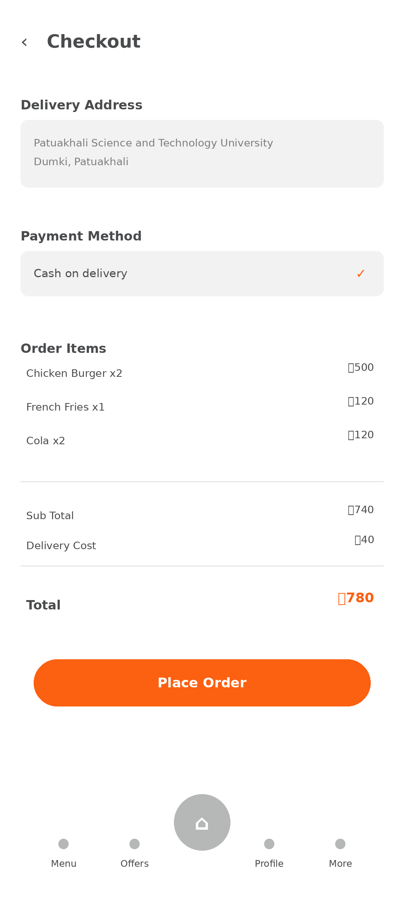
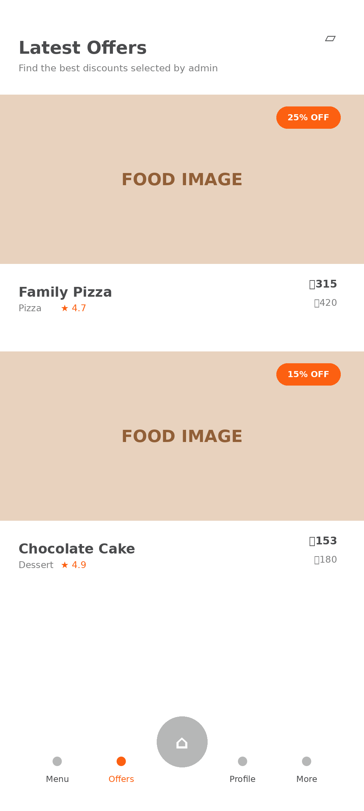
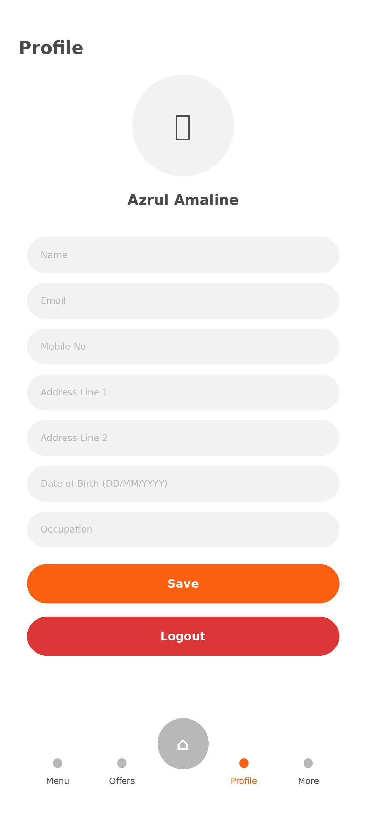

# Meal Monkey

A Flutter food-ordering app for browsing dishes, building a cart, and placing delivery orders. Meal Monkey pairs a customer-facing mobile UI with Firebase-backed data and an admin dashboard for managing the menu and orders.

Built with **Flutter**, **Dart**, **Firebase Authentication**, and **Cloud Firestore**, with a custom Metropolis typeface and orange-accented interface.

## App UI showcase

Explore the customer journey through the mockups below. Images are stored in [`mockups/`](mockups/) and can be opened at full size.

### Welcome and sign in

| Splash | Landing | Login |
| :---: | :---: | :---: |
|  |  |  |

### Discover your next meal

| Home | Menu | Food details |
| :---: | :---: | :---: |
|  |  |  |

### Order and checkout

| My order | Checkout |
| :---: | :---: |
|  |  |

### Offers and profile

| Offers | Profile |
| :---: | :---: |
|  |  |

## Features

### Customer experience

- Onboarding, account registration, and email/password sign-in.
- Firestore-backed food browsing with category filters, search, sorting, and popular dishes.
- Food detail pages with descriptions, ratings, and pricing in BDT.
- A persistent cart with quantity updates and item removal.
- Checkout with a delivery address, order summary, and cash on delivery.
- Order status updates and inbox messages.
- Profile editing, saved payment methods, and screens for offers and notifications.

### Admin dashboard

- Dashboard metrics for foods, orders, and gross sales.
- Add, edit, preview, hide, and delete menu items.
- Review customer orders and update their status.
- Automatically write customer inbox notifications when order statuses change.

## Getting started

### Prerequisites

- Flutter SDK with Dart **3.11.4 or a compatible 3.x version** (`^3.11.4`).
- An Android device or emulator and the Android development toolchain.
- A Firebase project with **Email/Password Authentication** and **Cloud Firestore** enabled.

The included Firebase options support Android. Other targets require additional Firebase configuration.

### 1. Clone and install

```bash
git clone https://github.com/Azrul16/Meal-Monkey.git
cd Meal-Monkey
flutter pub get
```

### 2. Configure the environment

Copy [`.env.example`](.env.example) to `.env` in the project root and replace the placeholders with your Firebase project values and admin login credentials:

```env
FIREBASE_API_KEY=your_firebase_api_key
FIREBASE_APP_ID=your_android_firebase_app_id
FIREBASE_MESSAGING_SENDER_ID=your_sender_id
FIREBASE_PROJECT_ID=your_project_id
FIREBASE_STORAGE_BUCKET=your_storage_bucket
ADMIN_USERNAME=admin@example.com
ADMIN_PASSWORD=your_admin_password
```

The app loads `.env` at startup, and `lib/firebase_options.dart` uses it to initialize Firebase for Android.

### 3. Run the app

```bash
flutter run
```

Use the admin credentials from `.env` on the login screen to open the admin dashboard. Menu items can be added through the dashboard and are stored in the `foods` collection.

For additional platforms, use the FlutterFire CLI to generate the appropriate configuration:

```bash
flutterfire configure
```

Review the generated options and platform setup before running on a new target.

## Project structure

```text
lib/
  const/                 Shared colors
  screens/               Customer screens and admin dashboard
  utils/                 Formatting and UI helpers
  widgets/               Reusable UI components
  firebase_options.dart  Platform-specific Firebase options
  main.dart              Startup, routes, and theme
assets/
  fonts/                 Metropolis font family
  images/                Food, brand, and interface assets
mockups/                 App UI showcase images
test/                    Flutter tests
```

Platform shells are included for Android, iOS, web, Linux, macOS, and Windows.

## Firestore collections

| Path | Purpose |
| --- | --- |
| `foods/{foodId}` | Menu details, pricing, ratings, images, and availability |
| `users/{uid}` | Customer profile and delivery address |
| `users/{uid}/cart/{cartItemId}` | Customer cart items |
| `users/{uid}/payment_methods/{methodId}` | Saved payment method records |
| `users/{uid}/inbox/{messageId}` | Customer messages and order updates |
| `orders/{orderId}` | Order items, totals, delivery details, and status |

Orders use these statuses: `pending`, `accepted`, `preparing`, `on_the_way`, `delivered`, and `cancelled`.

## Development commands

```bash
flutter analyze
flutter test
flutter build apk
dart run flutter_launcher_icons
```

## Current scope

- Checkout uses cash on delivery; saved payment method screens do not imply an integrated payment gateway.
- Google and Facebook login buttons are present, but their authentication flows are not configured.
- Firebase options are currently configured for Android only.
- Admin login compares credentials bundled in the app's `.env`; production admin authorization needs server-enforced access controls and appropriate Firestore rules.

## License

No license file is currently included in this repository.
